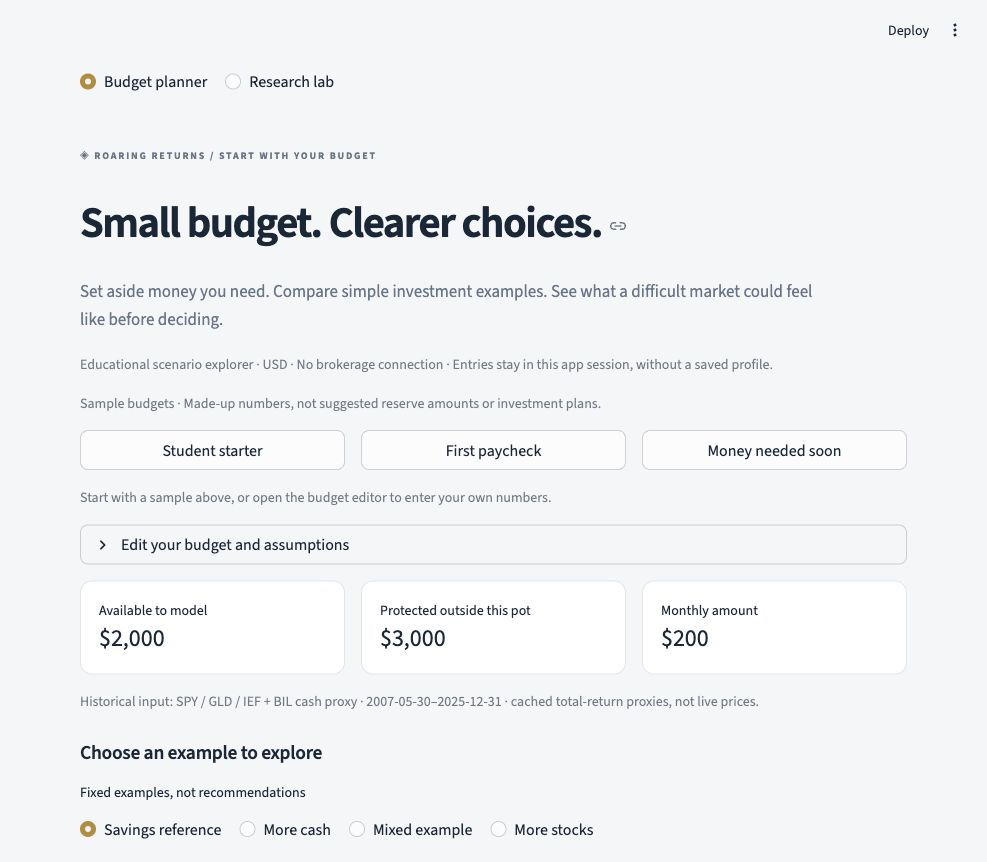

# Beginner budget planner (v0.3)

The homepage is an English, USD educational scenario explorer for a small
investment pot. It starts with the user's budget, protects money needed for
reserves and near-term spending, and compares four fixed examples. A dollar
loss-comfort input marks outcomes that cross the user's line; it never selects,
ranks or recommends an allocation. Sample profiles are made-up budgets, not
suggested reserve amounts. Savings reference is the initial selection.



[Scenario range preview](demo/budget_paths.jpg) · [Daily stress animation preview](demo/budget_stress.jpg)

## Budget and trading contract

- Initial investment pot = max(savings − protected reserve − near-term money, 0).
  Protected cash remains outside every chart and goal calculation.
- If protected cash is underfunded, monthly saving fills that gap first. Only
  the remainder enters the pot. Monthly saving is fixed nominal dollars.
- Examples have weights in the order cash / US stocks / gold / 7–10y Treasury
  fund: 100/0/0/0, 65/15/5/15, 20/40/15/25, and 5/70/10/15 percent.
- New money is allocated in proportion to positive dollar shortfalls. This is
  **not** the research lab's L2 purchase-only projection. If the resulting
  month-end allocation is more than 5pp from a target, the cash-first option
  resets to that example with a single set of net trades from marked holdings.
  A contributions-only comparison does not sell.
- Fees apply to risky-asset purchases and sales. The reset solves for final
  wealth after fees; it does not buy and then sell the same asset unnecessarily.
  Fractional return units, no taxes, no fixed fees and no whole-share constraint.
- Dollar dip is the largest fall from a high-water mark that rises with external
  deposits. It is not a percentage drawdown or a loss cap. New deposits cannot
  erase a previously observed investment loss.

## Data and cash assumptions

`python -m roaring_returns fetch-planner` creates a separate, hashed cache for
SPY / GLD / IEF / BIL. It leaves the QQQ-based research snapshot and v0.2
numerical modules unchanged. The available common daily interval in the local
snapshot is **2007-05-30 through 2025-12-31**, giving 223 completed monthly
returns (June 2007–December 2025). Raw files and processed provider indices are
excluded from Git. A clean checkout without the snapshot runs a conspicuously
labeled synthetic demonstration, including designed rather than historical stress.

SPY represents US large-cap stocks, IEF is a 7–10 year Treasury fund with interest
rate risk, and BIL is a short-term Treasury ETF used only to estimate historical
cash-relative returns. They are proxies, not a complete investment universe.
See the official [SPY](https://www.ssga.com/us/en/individual/etfs/state-street-spdr-sp-500-etf-trust-spy),
[IEF](https://www.ishares.com/us/products/239456/ishares-710-year-treasury-bond-etf),
and [BIL](https://www.ssga.com/us/en/individual/etfs/state-street-spdr-bloomberg-1-3-month-t-bill-etf-bil)
product descriptions. No present yield or product quote is used as a guaranteed rate.

Prices are vendor-adjusted total-return-unit proxies with implicit reinvestment.
They are not executable per-share prices or spendable dividend ledgers.
The downloader checks ordinary-day Close/AdjClose return consistency, matching
calendars, and split-date continuity. BIL's 2017-11-30 reverse split is already
reflected in historical prices; applying the factor again would double-adjust it.
These checks use one provider snapshot, not independent data validation.

For joint monthly asset and BIL log returns, each future risky return is:

```
log(1 + scenario_asset_return)
  = historical_asset_log_return − historical_BIL_log_return
    + log(1 + assumed_cash_rate)/12 − premium_reduction/12
```

The same cash-rate anchor therefore enters cash and risky assets. The initial cash-rate assumption matches the snapshot's annualized geometric
BIL return (about 1.30%); inflation starts at 2.5%. Both are editable constant
future assumptions, not observed CPI,
market quotes or deposit guarantees. Default premium reduction is zero; users
can test e.g. a 2 log pp/year reduction. Rebasing does not estimate how bond
prices would respond to a different yield curve, duration or future inflation.
Raising the cash assumption raises every modeled asset's log return equally
(constant-premium assumption). It does not remove this sample's unusually strong
gold or equity performance. BIL is net of fund expenses; its excess-return
baseline is therefore a proxy rather than a pure frictionless short rate.

## Two different time scales

**Stress first:** daily-close historical patterns for 2008–09, February–April
2020 and 2022 are replayed against the made-up or entered budget. Existing
holdings earn each session's observed risky-asset return; contributions and
net trades occur only at month-end. Cash follows the observed BIL total-return proxy rather than the future
constant rate. It is not an insured deposit return. No premium haircut is applied to observed
risky returns. Dates, holdings, deposits and a daily-close dollar dip are shown.
Intraday lows are still omitted. This is a historical-pattern what-if, not an
actual historical bank balance or the lab's next-day order-execution model.
Three-asset test fixtures without BIL use the constant cash assumption by
elapsed calendar days / 365.25; the historical homepage always supplies BIL.

**Possible paths:** 800 seeded scenarios resample all four assets jointly in
circular six-month blocks. Future values, fees and dips are observed monthly;
cash earns the monthly compound equivalent of the assumption. Prefixes stay
identical when only the horizon changes. All examples use identical draws.
Percentile curves are pointwise, not real paths, coverage intervals or forecasts.
At six months there is one block per path and only 223 possible block starts;
repeated draws add no new historical information. Circular blocks can join
December 2025 to June 2007. Historical crises may repeat, but unseen crises and
structural changes are not represented. No new prospective holdout is claimed.

Today's-dollar charts divide values by assumed inflation. Ending cards always
use today's dollars; the chart switch changes chart units only. The fraction
ending below cumulative deposits is explicitly **nominal**. A goal frequency
is shown only for a positive optional goal. Future dip frequencies are labeled
**month-end**, because intramonth losses can be much deeper.

## Interaction, privacy and ML

The animation plays the first path from a fixed seed, or the selected historical
pattern, rather than a picked winner. It initially shows the complete static
path and supports replay, pause, reset and a keyboard timeline. Reduced-motion
preferences disable automatic playback. Dates are shown for daily replay.

Budget-dependent results live in the Streamlit session, without a saved profile,
telemetry or brokerage connection. Downloading a JSON summary is an explicit
user action and includes the entered budget. A remotely hosted Streamlit server
would receive entries in its session; this local demonstration is not a promise
of browser-only execution. Public data can be cached globally, personal budgets
cannot. No entered budgets are committed to the repository.

The research lab remains available from the workspace switch. Its ridge model
estimates one-session volatility and retained negative findings versus EWMA.
It does not generate multi-year homepage returns or select assets for the user.

## Review and validation

Claude's AI-assisted read-only review identified the initial mismatch between
historical bond returns and an unrelated future cash rate, and the use of
month-end dips in stress replay. Both were corrected before publication, along
with default-selection, reserve-example and nominal/real labels. Tests cover
cash-anchor equivalence, intramonth crash/recovery, monthly funding dates,
fee conservation, reserve funding, future-data contamination, common scenario
paths and Streamlit navigation. Original v0.2 numeric/export hashes remain valid.

This educational tool cannot establish suitability, forecast future returns,
cap losses, estimate taxes, or demonstrate alpha. Investment selection, leverage,
broker execution, tax-lot accounting and prospective model validation are outside
this homepage's scope.
