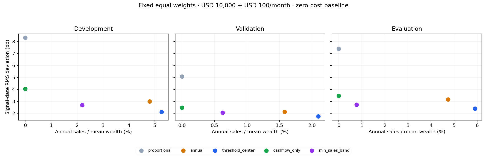

# Historical results

Generated from the frozen v0.1 baseline. There are 45 main scenarios per segment
(135 total), plus 15 width and 5 cost cases per segment. Three C=0 buy-only
scenarios duplicate their proportional controls within each segment.
Each segment is an independently initialized account, not a continuous account.
These are retrospective case studies on a chosen ETF universe. There are no
confidence intervals, prospective record, or strategy-superiority claims.

## USD 10,000 initial wealth + USD 100/month

| Period | Rule | Signal RMS (pp) | Annual sales / mean wealth | Post-fill outside band |
|---|---|---:|---:|---:|
| development | proportional | 8.321 | 0.00% | 87.5% |
| development | annual | 3.009 | 4.80% | 14.2% |
| development | threshold_center | 2.120 | 5.26% | 0.8% |
| development | cashflow_only | 4.054 | 0.00% | 35.0% |
| development | min_sales_band | 2.688 | 2.20% | 9.2% |
| validation | proportional | 5.080 | 0.00% | 53.3% |
| validation | annual | 2.129 | 1.58% | 3.3% |
| validation | threshold_center | 1.762 | 2.10% | 0.0% |
| validation | cashflow_only | 2.483 | 0.00% | 13.3% |
| validation | min_sales_band | 2.066 | 0.62% | 6.7% |
| evaluation | proportional | 7.395 | 0.00% | 81.9% |
| evaluation | annual | 3.159 | 4.74% | 23.6% |
| evaluation | threshold_center | 2.411 | 5.91% | 1.4% |
| evaluation | cashflow_only | 3.479 | 0.00% | 31.9% |
| evaluation | min_sales_band | 2.727 | 0.77% | 13.9% |

The signal-price minimum-sale plan trades off drift against selling; its static
optimality is not a guarantee of best cumulative sales or post-fill compliance.
A delayed band-edge order can cross the band before it fills. Check post-trade
metrics and each report's selling-month failure rate alongside signal metrics.
Return is secondary; allocation drift is not itself financial risk. No band or
target was changed after observing validation/evaluation outcomes.

## Full reports and audit trail

- [Development report](development_RESEARCH_REPORT.md)
- [Validation report](validation_RESEARCH_REPORT.md)
- [Evaluation report](evaluation_RESEARCH_REPORT.md)

CSV tables contain aggregate model outputs, not vendor price histories. Raw
provider snapshots, processed return indices, per-session/per-asset ledgers and
local credentials are excluded. Download locally using the included fetcher.
Manifests retain snapshot hashes, acquisition times, code hashes, and parameters.
A fresh provider download may revise historical adjustments, so matching the
original hashes is necessary for exact numeric replication.
