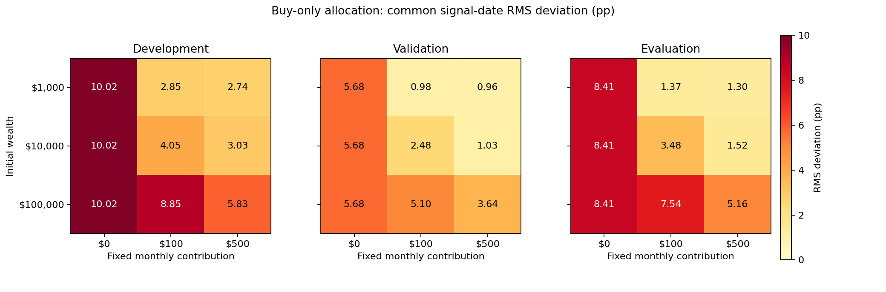

# Historical results

Generated from the frozen v0.1 baseline. There are 45 main scenarios per segment
(135 total), plus 15 width and 5 cost cases per segment. Three C=0 buy-only
scenarios duplicate their proportional controls within each segment.
Each segment is an independently initialized account, not a continuous account.
These are retrospective case studies on a chosen ETF universe. There are no
confidence intervals, prospective record, or strategy-superiority claims.

## USD 10,000 initial wealth + USD 100/month

| Period | Rule | Signal RMS (pp) | Annual sales / mean wealth | Post-fill outside band |
|---|---|---:|---:|---:|
| development | proportional | 8.321 | 0.00% | 87.5% |
| development | annual | 3.009 | 4.80% | 14.2% |
| development | threshold_center | 2.120 | 5.26% | 0.8% |
| development | cashflow_only | 4.054 | 0.00% | 35.0% |
| development | min_sales_band | 2.688 | 2.20% | 9.2% |
| validation | proportional | 5.080 | 0.00% | 53.3% |
| validation | annual | 2.129 | 1.58% | 3.3% |
| validation | threshold_center | 1.762 | 2.10% | 0.0% |
| validation | cashflow_only | 2.483 | 0.00% | 13.3% |
| validation | min_sales_band | 2.066 | 0.62% | 6.7% |
| evaluation | proportional | 7.395 | 0.00% | 81.9% |
| evaluation | annual | 3.159 | 4.74% | 23.6% |
| evaluation | threshold_center | 2.411 | 5.91% | 1.4% |
| evaluation | cashflow_only | 3.479 | 0.00% | 31.9% |
| evaluation | min_sales_band | 2.727 | 0.77% | 13.9% |

The signal-price minimum-sale plan trades off drift against selling; its static
optimality is not a guarantee of best cumulative sales or post-fill compliance.
A delayed band-edge order can cross the band before it fills. Check post-trade
metrics and each report's selling-month failure rate alongside signal metrics.
Return is secondary; allocation drift is not itself financial risk. No band or
target was changed after observing validation/evaluation outcomes.

## Full reports and audit trail

- [Development report](development_RESEARCH_REPORT.md)
- [Validation report](validation_RESEARCH_REPORT.md)
- [Evaluation report](evaluation_RESEARCH_REPORT.md)

CSV tables contain aggregate model outputs, not vendor price histories. Raw
provider snapshots, processed return indices, per-session/per-asset ledgers and
local credentials are excluded. Download locally using the included fetcher.
Manifests retain snapshot hashes, acquisition times, code hashes, and parameters.
A fresh provider download may revise historical adjustments, so matching the
original hashes is necessary for exact numeric replication.

## Cash-flow intensity and reachability

Larger contributions relative to initial wealth reduced buy-only drift in these
cases. Initial C/W0 is a scenario label; C/W changes along each account path
and can rise in losses. It is not a constant explanatory variable. The older
per-period contribution maps show daily band exposure, a secondary metric.

| Period | Buy-only RMS at C=0 (pp) | Buy-only RMS at initial C/W0=1% (pp) |
|---|---:|---:|
| development | 10.017 | 4.054 |
| validation | 5.676 | 2.483 |
| evaluation | 8.412 | 3.479 |

Reachability below uses the **buy-only policy's carried holdings** in the
representative account. These are signal-price, zero-cost feasibility
fractions, not delayed-fill success rates or a calibrated forecast.

| Period | Exact target reachable without sales | ±5pp band reachable without sales | Initial / final signal C/W |
|---|---:|---:|---:|
| development | 2.5% | 62.5% | 1.00% / 0.22% |
| validation | 1.7% | 85.0% | 1.00% / 0.45% |
| evaluation | 4.2% | 69.4% | 1.00% / 0.31% |

## Delayed execution: counts and size of violations

| Period | Outside / selling months | Outside / all execution months | Median overshoot (pp) | Maximum overshoot (pp) |
|---|---:|---:|---:|---:|
| development | 11/21 | 11/120 | 0.353 | 0.888 |
| validation | 2/4 | 4/60 | 0.242 | 0.282 |
| evaluation | 7/11 | 10/72 | 0.083 | 0.749 |

Overshoot is max(absolute asset-weight deviation) minus 5pp, measured
only in violating selling months of the representative minimum-sale plan.
Small denominators (notably four selling months in validation) prevent
treating percentage differences as evidence of regime deterioration.

## Comparing different widths

At equal 5pp bands the minimum-sale plan has less selling and greater drift
than threshold-to-center. Across widths, the 2pp minimum-sale cases have
both lower signal RMS and lower sale amounts than the 5pp center cases
in all three segments. They also sell in more months. This is a descriptive
historical observation, without uncertainty intervals or a superiority claim.

| Period | Rule / own band | Signal RMS (pp) | Post-trade RMS (pp) | Annual sales / mean wealth | Selling months |
|---|---|---:|---:|---:|---:|
| development | min_sales_band / 2pp | 1.681 | 1.173 | 4.44% | 45 |
| development | threshold_center / 5pp | 2.120 | 1.811 | 5.26% | 9 |
| validation | min_sales_band / 2pp | 1.345 | 1.061 | 1.51% | 17 |
| validation | threshold_center / 5pp | 1.762 | 1.618 | 2.10% | 2 |
| evaluation | min_sales_band / 2pp | 1.631 | 1.241 | 3.26% | 28 |
| evaluation | threshold_center / 5pp | 2.411 | 2.106 | 5.91% | 6 |

Outside-own-band fractions cannot be compared directly across different
widths. Use RMS or a common absolute threshold. The 10pp minimum-sale and
buy-only cases coincide in validation and evaluation; those points are
duplicate outcomes, not independent evidence. At 5pp, annual rebalancing
has both greater signal RMS and more selling than the minimum-sale rule
in these representative cases; other objectives can rank them differently.

Public report copies receive link and wording edits after generation.
Their numerical tables are unchanged. Historical source hashes preserve
the numerical run state; export-script changes affect presentation only.
