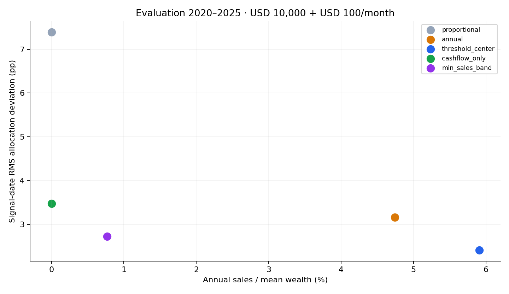
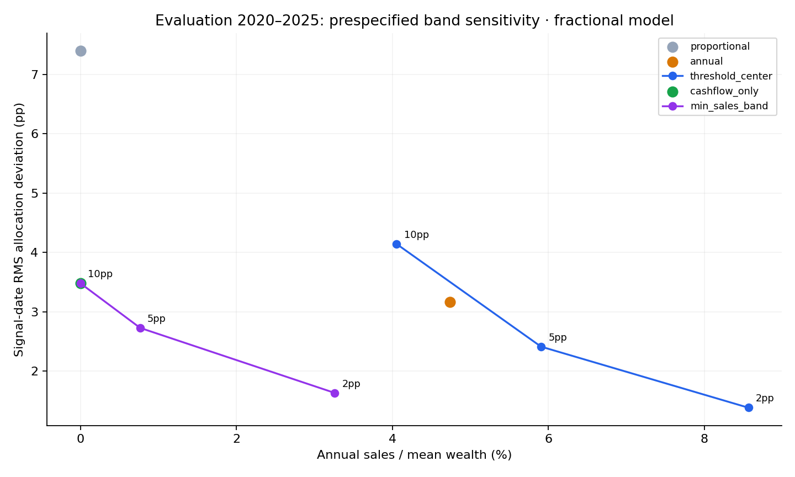
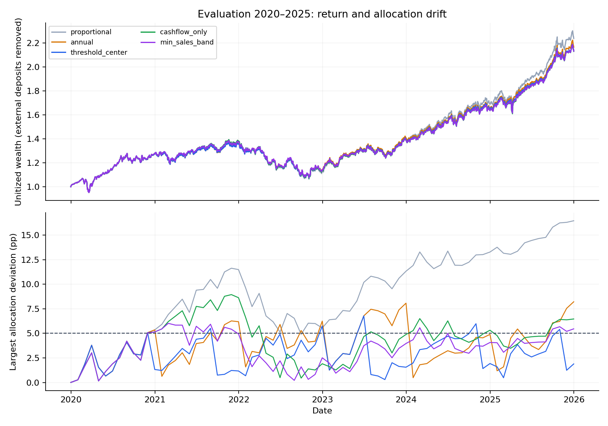
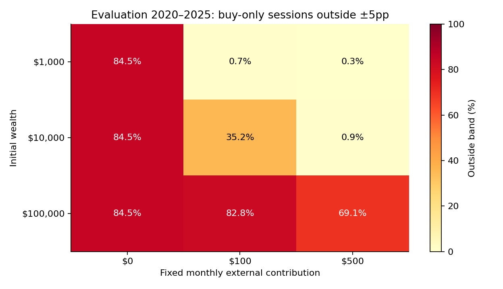

# Roaring Returns — evaluation run

Python research prototype v0.1.0. This is an exploratory implementation result,
not evidence of a novel strategy or a completed investment recommendation.

Period: 2020-01-01 to 2025-12-31; 45 scenarios plus a separate
10bp cost stress. Each scenario starts afresh at the previous-session close.
Target: QQQ 33.33%, GLD 33.33%, IEF 33.33%; baseline band: ±5 percentage points.
Prespecified sensitivity bands: 2pp, 5pp, 10pp.

## Representative account: USD 10,000 + USD 100 each month

| Strategy | Signal RMS (pp) | Post-trade RMS (pp) | Post-trade outside band | Annual sales / mean wealth |
|---|---:|---:|---:|---:|
| proportional | 7.395 | 7.360 | 81.9% | 0.0% |
| annual | 3.159 | 2.956 | 23.6% | 4.7% |
| threshold_center | 2.411 | 2.106 | 1.4% | 5.9% |
| cashflow_only | 3.479 | 3.324 | 31.9% | 0.0% |
| min_sales_band | 2.727 | 2.513 | 13.9% | 0.8% |

## Interpretation and limits

Zero sales in the buy-only rules is a constraint, not a finding. Read its drift
alongside it. The hybrid (min_sales_band)'s low sales are a one-state implementation objective,
not a proof of best cumulative trading or best returns. Baselines receive the
same monthly contributions, and thresholds and weights are not chosen from
these results. Daily observations on one history are not independent samples.
Primary deviation metrics use the same signal dates and execution dates for all
rules. Daily outside-band frequency remains a secondary path exposure measure:
a boundary rule is naturally more likely to cross its band than a center reset.
Band-sensitivity points are descriptive comparisons, not a proven efficient
frontier or a reason to select the best historical width. With zero new cash,
proportional and buy-only rules coincide; duplicate controls are kept transparent.

In the representative account, the signal-price minimum-sale plan finished outside its own band in 63.6% of months with positive sales. This is a measured execution limitation; the report does not retune a buffer to conceal it.

Orders are planned from the previous close and executed in fixed dollars at the
next session close. Existing holdings earn that session's return before external
cash arrives. TWR links the pre-flow market factor and post-flow execution factor.
Fees reduce wealth; buys are reduced if needed to avoid borrowing. Consequently,
delayed or cost-adjusted fills need not restore the ideal frictionless band.

Data: Yahoo Finance publicly accessible chart data; vendor adjusted-close ratios
are a **total-return proxy**, with implicit reinvestment in the original asset.
No separate dividend cash is added. These are normalized fractional return units,
not historical executable ETF share prices. Pay-date income, whole shares, taxes,
bid/ask spread dynamics, and market impact are not implemented. Cash earns zero.
Returns were not cross-checked against CRSP or any second provider; only same-snapshot internal checks were run.

Data hash: `49269e7636729f91a288d37d5fa7dbe9bbcf874e1eddefc381cf3fd64fd6dd03`. Protocol hash: `7aa19706375d0cd2652c6f7e0eb0f3f8119e2086b6c9552f4108b3785b7da6b3`.
See `evaluation_run_manifest.json` and `evaluation_summary.csv` for auditable details.
Acquisition dates and hashes are in `evaluation_data_manifest_snapshot.json`. Raw prices and detailed ledgers stay local.

Full cached data span: 2004-12-01 to
2025-12-31. Chronological splits are explicit in
`configs/baseline.json`; running development does not run evaluation.

## Data resources for the next version

- [Public reader behavior / adjustment documentation](https://ranaroussi.github.io/yfinance/reference/yfinance.price_history.html)
- [Columbia WRDS access](https://guides.library.columbia.edu/WRDS/overview)
- [Columbia subscribed data collections](https://guides.library.columbia.edu/WRDS/collection)
- [Time-weighted return principles](https://www.gipsstandards.org/standards/gips-standards-for-asset-owners/gips-standards-handbook-for-asset-owners/)

Before a pay-date/whole-share extension, obtain prices, split factors, distribution
amounts, ex-dates and payment dates under a verified data contract. Do not turn
adjusted-close levels into integer historical share counts.

Width values were in the early design; sensitivity analysis was added after the first development run and before later-period outcomes were inspected. The 10bp stress charges each gross purchase and sale amount; it is not a broker quote. TWR removes external-flow timing; investor dollar outcomes differ and money-weighted returns are not computed.
