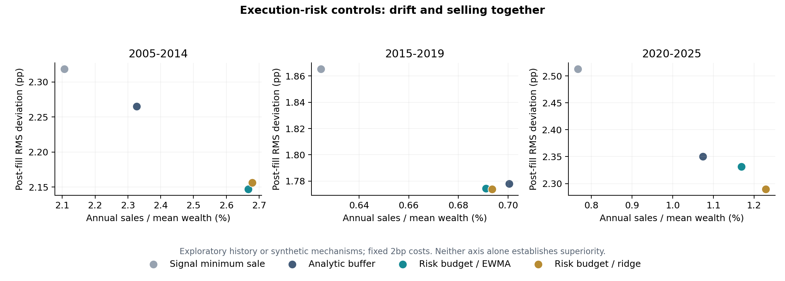

# Execution-risk research v0.2

**Exploratory retrospective study; previously inspected history.**

Data: cached Yahoo adjusted-close return-unit proxy. 36 fixed configurations. No historical parameter search.

Account: USD 10,000 + USD 100/month; equal targets; 5pp band; 2bp per purchase/sale dollar.

Previous-close frozen dollar plans fill at next session close. Return-unit proxies with implicit income reinvestment.

All methods share 252 pre-decision warm-up sessions; the first requested window starts after warm-up. Exact realized start/end are in summary.csv.

Selling-month counts below exclude sales of at most 1e-6 of signal wealth (USD 0.01 for a USD 10,000 account), uniformly across methods. The raw summary preserves the legacy >1e-7 USD count.

| Requested window | Strategy | Post-fill RMS (pp) | Outside / months | Material selling months | Annual sales / mean wealth | Fees (USD) |
| --- | --- | ---: | ---: | ---: | ---: | ---: |
| 2005-2014 | Proportional contributions | 7.079 | 86/108 | 0 | 0.00% | 4.16 |
| 2005-2014 | Annual reset | 2.824 | 17/108 | 8 | 4.83% | 8.44 |
| 2005-2014 | Threshold to center | 1.841 | 1/108 | 9 | 5.35% | 8.85 |
| 2005-2014 | Buy only | 3.766 | 27/108 | 0 | 0.00% | 4.16 |
| 2005-2014 | Signal minimum sale | 2.319 | 10/108 | 19 | 2.11% | 6.01 |
| 2005-2014 | Analytic lag buffer | 2.265 | 3/108 | 21 | 2.33% | 6.21 |
| 2005-2014 | Cost-aware QP | 0.393 | 0/108 | 101 | 12.67% | 15.31 |
| 2005-2014 | Scenario / historical | 0.393 | 0/108 | 99 | 12.67% | 15.31 |
| 2005-2014 | Scenario / EWMA | 0.393 | 0/108 | 99 | 12.67% | 15.31 |
| 2005-2014 | Scenario / ridge volatility | 0.393 | 0/108 | 99 | 12.67% | 15.31 |
| 2005-2014 | Risk-budget sales / EWMA | 2.147 | 2/108 | 25 | 2.67% | 6.51 |
| 2005-2014 | Risk-budget sales / ridge | 2.157 | 3/108 | 25 | 2.68% | 6.52 |
| 2015-2019 | Proportional contributions | 5.067 | 32/60 | 0 | 0.00% | 3.20 |
| 2015-2019 | Annual reset | 2.054 | 2/60 | 4 | 1.58% | 3.68 |
| 2015-2019 | Threshold to center | 1.618 | 0/60 | 2 | 2.10% | 3.84 |
| 2015-2019 | Buy only | 2.349 | 8/60 | 0 | 0.00% | 3.20 |
| 2015-2019 | Signal minimum sale | 1.865 | 4/60 | 4 | 0.62% | 3.39 |
| 2015-2019 | Analytic lag buffer | 1.778 | 0/60 | 5 | 0.70% | 3.41 |
| 2015-2019 | Cost-aware QP | 0.282 | 0/60 | 52 | 8.41% | 5.77 |
| 2015-2019 | Scenario / historical | 0.282 | 0/60 | 51 | 8.41% | 5.77 |
| 2015-2019 | Scenario / EWMA | 0.282 | 0/60 | 51 | 8.41% | 5.77 |
| 2015-2019 | Scenario / ridge volatility | 0.282 | 0/60 | 51 | 8.41% | 5.77 |
| 2015-2019 | Risk-budget sales / EWMA | 1.774 | 0/60 | 5 | 0.69% | 3.41 |
| 2015-2019 | Risk-budget sales / ridge | 1.774 | 0/60 | 4 | 0.69% | 3.41 |
| 2020-2025 | Proportional contributions | 7.360 | 59/72 | 0 | 0.00% | 3.44 |
| 2020-2025 | Annual reset | 2.956 | 17/72 | 5 | 4.74% | 5.53 |
| 2020-2025 | Threshold to center | 2.106 | 1/72 | 6 | 5.91% | 6.04 |
| 2020-2025 | Buy only | 3.324 | 23/72 | 0 | 0.00% | 3.44 |
| 2020-2025 | Signal minimum sale | 2.513 | 10/72 | 11 | 0.77% | 3.78 |
| 2020-2025 | Analytic lag buffer | 2.351 | 1/72 | 14 | 1.07% | 3.91 |
| 2020-2025 | Cost-aware QP | 0.309 | 0/72 | 65 | 10.90% | 8.20 |
| 2020-2025 | Scenario / historical | 0.309 | 0/72 | 64 | 10.90% | 8.20 |
| 2020-2025 | Scenario / EWMA | 0.309 | 0/72 | 64 | 10.90% | 8.20 |
| 2020-2025 | Scenario / ridge volatility | 0.309 | 0/72 | 64 | 10.90% | 8.20 |
| 2020-2025 | Risk-budget sales / EWMA | 2.332 | 1/72 | 14 | 1.17% | 3.95 |
| 2020-2025 | Risk-budget sales / ridge | 2.290 | 0/72 | 12 | 1.23% | 3.98 |

## Observed model and numerical results

Ridge variance QLIKE is worse than EWMA in 3/3 windows (lower is better); this is not evidence that ML improved forecasts.

| Requested window | Historical QLIKE | EWMA QLIKE | Ridge QLIKE | Ridge variance clips¹ |
| --- | ---: | ---: | ---: | ---: |
| 2005-2014 | -8.072 | -8.166 | -7.675 | 14 |
| 2015-2019 | -8.710 | -8.813 | -8.504 | 4 |
| 2020-2025 | -8.225 | -8.296 | -7.989 | 14 |

¹ Counts asset forecasts clipped to 0.1–10× EWMA variance at monthly origins, once per risk-budget/ridge policy path; they are not independent repeated experiments.

The tracking QPs trade toward the center and have nearly identical aggregate outcomes across covariance models at these settings. Under frozen-dollar fills, the random part of squared dollar tracking is largely independent of the trade; models matter through active tail constraints. This similarity is not evidence of learned robustness.

The analytic buffer is a strong inexpensive comparator. Risk-budget LPs do not establish superiority over it; inspect selling, drift and fees together. Published paired intervals compare against signal minimum sale, not directly against the buffer.

Same-program solver retries: 28; LP-only months with incomplete target-nearest tie-break: 0. Counts are strategy-month solves, not unique market dates.

Risk-budget slack months above 1e-6 normalized capital: 0. Zero means the soft budget was not materially relaxed on these paths; it does not guarantee future feasibility.

## Interpretation contract

- Compare violation counts and sizes together with selling, fees, and post-fill RMS. Lower drift alone is not superiority.
- The analytic buffer is a first-order, per-asset approximation, not a joint 95% guarantee.
- Scenario QPs optimize squared dollar tracking, gross trading penalty, and finite-scenario CVaR. They do not minimize the original static sale bound.
- Risk-budget sales policies minimize sales plus 50 times soft risk-budget slack. Risk budget is 0.0005 of signal-plus-flow capital; all excess slack is reported. A tracking tie-break stays within 1e-6 of the primary objective and caps sales/slack separately at the LP solution (1e-9/1e-10 normalized roundoff); a buy-only optimal face enforces zero sales. Tracking cannot spend the main tolerance on micro-sales.
- A failed tie-break retries the same QP with OSQP, then preserves the verified first-stage LP solution if necessary. `tie_break_incomplete_months` explicitly counts those cases; they do not have the target-nearest guarantee. A failed first-stage solve or feasibility check aborts the study.
- CVaR is on normalized dollar excess, not exact percentage-weight excess. The denominator is fixed signal wealth plus contribution.
- Scenarios use every available one of the last 252 causally filtered joint historical residuals. Designed stress shocks are excluded from the default distribution and remain separate demo what-if inputs. Tail levels are not calibrated real-market probabilities.
- Ridge estimates next-session variance using matured labels. It does not forecast alpha or train through the optimizer.
- `risk_diagnostics.csv` scores next execution-session variance QLIKE, independently of which trading policy is selected.
- `paired_intervals.csv` resamples paired monthly outcomes in six-month circular blocks. These are conditional descriptive intervals, not full refit/path bootstrap or new out-of-sample evidence.
- Legacy rules leave proportional-cost scaling to the fill engine; the QPs anticipate those fees in their budget. `fill_adjusted_months` exposes resulting adjustments.
- Market impact, taxes, share granularity, live execution, and spendable dividend-cash accounting are outside this experiment.

All settings, numerical source hashes, cached data hash, environment, and solver failures are recorded in manifest.json.

