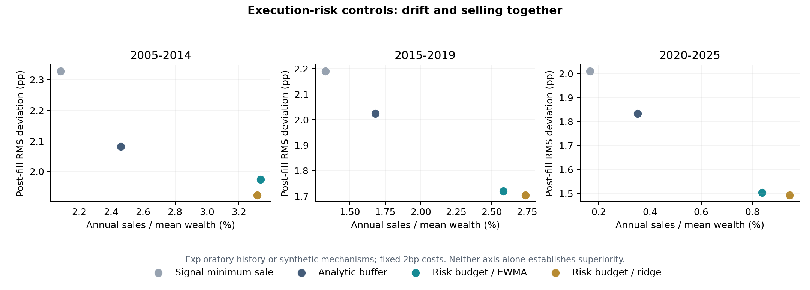

# Execution-risk research v0.2

**Exploratory retrospective study; previously inspected history.**

Data: SYNTHETIC regime-switching Student-t paths; not market data. 36 fixed configurations. No historical parameter search.

Account: USD 10,000 + USD 100/month; equal targets; 5pp band; 2bp per purchase/sale dollar.

Previous-close frozen dollar plans fill at next session close. Return-unit proxies with implicit income reinvestment.

All methods share 252 pre-decision warm-up sessions; the first requested window starts after warm-up. Exact realized start/end are in summary.csv.

Selling-month counts below exclude sales of at most 1e-6 of signal wealth (USD 0.01 for a USD 10,000 account), uniformly across methods. The raw summary preserves the legacy >1e-7 USD count.

| Requested window | Strategy | Post-fill RMS (pp) | Outside / months | Material selling months | Annual sales / mean wealth | Fees (USD) |
| --- | --- | ---: | ---: | ---: | ---: | ---: |
| 2005-2014 | Proportional contributions | 5.590 | 80/120 | 0 | 0.00% | 4.40 |
| 2005-2014 | Annual reset | 4.036 | 48/120 | 9 | 5.30% | 7.57 |
| 2005-2014 | Threshold to center | 1.858 | 2/120 | 10 | 5.82% | 7.84 |
| 2005-2014 | Buy only | 3.987 | 44/120 | 0 | 0.00% | 4.40 |
| 2005-2014 | Signal minimum sale | 2.328 | 14/120 | 19 | 2.09% | 5.63 |
| 2005-2014 | Analytic lag buffer | 2.082 | 1/120 | 19 | 2.46% | 5.85 |
| 2005-2014 | Cost-aware QP | 0.312 | 0/120 | 107 | 11.88% | 11.41 |
| 2005-2014 | Scenario / historical | 0.318 | 0/120 | 105 | 11.88% | 11.41 |
| 2005-2014 | Scenario / EWMA | 0.330 | 0/120 | 105 | 11.99% | 11.48 |
| 2005-2014 | Scenario / ridge volatility | 0.322 | 0/120 | 105 | 12.02% | 11.50 |
| 2005-2014 | Risk-budget sales / EWMA | 1.975 | 0/120 | 21 | 3.34% | 6.38 |
| 2005-2014 | Risk-budget sales / ridge | 1.923 | 0/120 | 18 | 3.31% | 6.36 |
| 2015-2019 | Proportional contributions | 8.868 | 48/60 | 0 | 0.00% | 3.20 |
| 2015-2019 | Annual reset | 3.487 | 19/60 | 4 | 4.19% | 4.39 |
| 2015-2019 | Threshold to center | 1.525 | 0/60 | 6 | 6.91% | 5.17 |
| 2015-2019 | Buy only | 3.916 | 26/60 | 0 | 0.00% | 3.20 |
| 2015-2019 | Signal minimum sale | 2.190 | 6/60 | 7 | 1.33% | 3.58 |
| 2015-2019 | Analytic lag buffer | 2.023 | 1/60 | 8 | 1.68% | 3.68 |
| 2015-2019 | Cost-aware QP | 0.323 | 0/60 | 56 | 10.66% | 6.22 |
| 2015-2019 | Scenario / historical | 0.323 | 0/60 | 53 | 10.66% | 6.22 |
| 2015-2019 | Scenario / EWMA | 0.336 | 0/60 | 53 | 10.64% | 6.21 |
| 2015-2019 | Scenario / ridge volatility | 0.353 | 0/60 | 52 | 10.60% | 6.20 |
| 2015-2019 | Risk-budget sales / EWMA | 1.719 | 0/60 | 9 | 2.58% | 3.94 |
| 2015-2019 | Risk-budget sales / ridge | 1.703 | 0/60 | 11 | 2.74% | 3.98 |
| 2020-2025 | Proportional contributions | 3.882 | 29/72 | 0 | 0.00% | 3.44 |
| 2020-2025 | Annual reset | 2.403 | 8/72 | 5 | 3.10% | 4.42 |
| 2020-2025 | Threshold to center | 1.969 | 0/72 | 5 | 4.57% | 4.90 |
| 2020-2025 | Buy only | 2.095 | 4/72 | 0 | 0.00% | 3.44 |
| 2020-2025 | Signal minimum sale | 2.010 | 3/72 | 2 | 0.17% | 3.49 |
| 2020-2025 | Analytic lag buffer | 1.834 | 0/72 | 4 | 0.35% | 3.55 |
| 2020-2025 | Cost-aware QP | 0.260 | 0/72 | 63 | 10.84% | 6.90 |
| 2020-2025 | Scenario / historical | 0.260 | 0/72 | 63 | 10.84% | 6.90 |
| 2020-2025 | Scenario / EWMA | 0.262 | 0/72 | 63 | 10.84% | 6.90 |
| 2020-2025 | Scenario / ridge volatility | 0.262 | 0/72 | 63 | 10.88% | 6.92 |
| 2020-2025 | Risk-budget sales / EWMA | 1.503 | 0/72 | 6 | 0.84% | 3.71 |
| 2020-2025 | Risk-budget sales / ridge | 1.493 | 0/72 | 7 | 0.95% | 3.74 |

## Observed model and numerical results

Ridge variance QLIKE is worse than EWMA in 3/3 windows (lower is better); this is not evidence that ML improved forecasts.

| Requested window | Historical QLIKE | EWMA QLIKE | Ridge QLIKE | Ridge variance clips¹ |
| --- | ---: | ---: | ---: | ---: |
| 2005-2014 | -8.361 | -8.577 | -7.512 | 40 |
| 2015-2019 | -8.103 | -8.424 | -7.898 | 25 |
| 2020-2025 | -8.772 | -8.718 | -8.416 | 24 |

¹ Counts asset forecasts clipped to 0.1–10× EWMA variance at monthly origins, once per risk-budget/ridge policy path; they are not independent repeated experiments.

The tracking QPs trade toward the center and have nearly identical aggregate outcomes across covariance models at these settings. Under frozen-dollar fills, the random part of squared dollar tracking is largely independent of the trade; models matter through active tail constraints. This similarity is not evidence of learned robustness.

The analytic buffer is a strong inexpensive comparator. Risk-budget LPs do not establish superiority over it; inspect selling, drift and fees together. Published paired intervals compare against signal minimum sale, not directly against the buffer.

Same-program solver retries: 22; LP-only months with incomplete target-nearest tie-break: 2. Counts are strategy-month solves, not unique market dates.

Risk-budget slack months above 1e-6 normalized capital: 0. Zero means the soft budget was not materially relaxed on these paths; it does not guarantee future feasibility.

## Interpretation contract

- Compare violation counts and sizes together with selling, fees, and post-fill RMS. Lower drift alone is not superiority.
- The analytic buffer is a first-order, per-asset approximation, not a joint 95% guarantee.
- Scenario QPs optimize squared dollar tracking, gross trading penalty, and finite-scenario CVaR. They do not minimize the original static sale bound.
- Risk-budget sales policies minimize sales plus 50 times soft risk-budget slack. Risk budget is 0.0005 of signal-plus-flow capital; all excess slack is reported. A tracking tie-break stays within 1e-6 of the primary objective and caps sales/slack separately at the LP solution (1e-9/1e-10 normalized roundoff); a buy-only optimal face enforces zero sales. Tracking cannot spend the main tolerance on micro-sales.
- A failed tie-break retries the same QP with OSQP, then preserves the verified first-stage LP solution if necessary. `tie_break_incomplete_months` explicitly counts those cases; they do not have the target-nearest guarantee. A failed first-stage solve or feasibility check aborts the study.
- CVaR is on normalized dollar excess, not exact percentage-weight excess. The denominator is fixed signal wealth plus contribution.
- Scenarios use every available one of the last 252 causally filtered joint historical residuals. Designed stress shocks are excluded from the default distribution and remain separate demo what-if inputs. Tail levels are not calibrated real-market probabilities.
- Ridge estimates next-session variance using matured labels. It does not forecast alpha or train through the optimizer.
- `risk_diagnostics.csv` scores next execution-session variance QLIKE, independently of which trading policy is selected.
- `paired_intervals.csv` resamples paired monthly outcomes in six-month circular blocks. These are conditional descriptive intervals, not full refit/path bootstrap or new out-of-sample evidence.
- Legacy rules leave proportional-cost scaling to the fill engine; the QPs anticipate those fees in their budget. `fill_adjusted_months` exposes resulting adjustments.
- Market impact, taxes, share granularity, live execution, and spendable dividend-cash accounting are outside this experiment.

All settings, numerical source hashes, cached data hash, environment, and solver failures are recorded in manifest.json.

